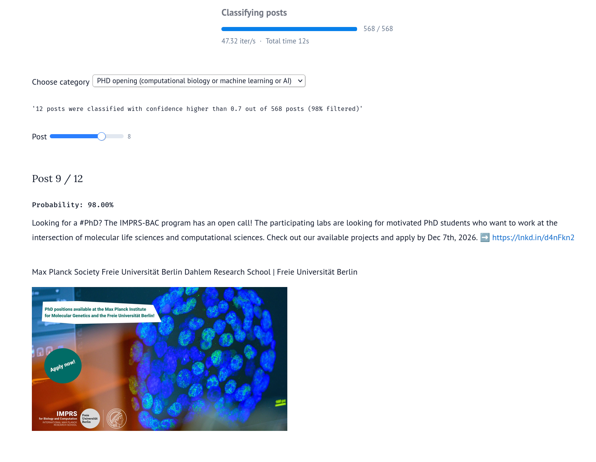

# LinkedIn Feed Collector

Linkedin can be a useful site to find interesting stuff and new opportunities, but it is riddled with low quality posts, so finding things useful to you quickly becomes a needle in a haystack problem.

This Chromium extension scrolls through your LinkedIn home feed and saves
each post to a SQLite database inside the browser: text, author, time, reaction/comment/repost
counts, repost details and images.


## What it collects

For every post in the feed:

- author name, headline and profile URL
- the activity line above the post, e.g. "Jane Doe likes this"
- relative time ("3d") and an estimated timestamp
- full text (truncated posts are expanded first)
- reaction, comment and repost counts
- whether it is a repost, and the original author and text if so
- whether it contains a video
- the images, downloaded and stored in the database
- the card's full visible text, so it can be re-parsed later if extraction misses something

Promoted posts are skipped by default.

## Requirements

- Chromium or Google Chrome 116 or newer
- Node.js 22 or newer, only for the scripts in `tools/`

## Installation

The extension is not in the Chrome Web Store. It is installed as an unpacked extension, which
Chromium allows when Developer mode is on.

### From a release

1. Download `linkedin-feed-collector-<version>.zip` from the Releases page and unzip it.
2. Open `chrome://extensions` and turn on **Developer mode** (top right).
3. Click **Load unpacked** and choose the unzipped `linkedin-feed-collector` folder.

Keep that folder where it is. Chromium loads the extension from it on every start, and the
collected data is tied to the folder's location (see [Data](#data)).

### From source

```bash
git clone <this repository>
cd linkedin-collector
./launch-chromium.sh
```

This starts Chromium with a separate profile in `~/.local/share/linkedin-collector/chromium-profile`
and the extension loaded from `extension/`. Your normal browser profile is not touched. Log in
to LinkedIn in this window once; the login is kept between launches.

The script also turns off Chromium's throttling of covered windows, so collection keeps going
while the window is behind others. Set `CHROMIUM_BIN` to pick a browser binary and
`CHROMIUM_PROFILE` to use another profile directory. The script is written for Linux and macOS;
elsewhere, load `extension/` with **Load unpacked** as above.

When loaded by hand, keep the window visible while collecting: Chromium pauses rendering of
covered windows, and LinkedIn then stops loading new posts.

## Usage

1. Open `https://www.linkedin.com/feed/`.
2. Click the extension's toolbar icon to open the side panel (pin it from the puzzle menu first).
3. Press **Start**.

The collector scrolls to one post at a time, expands its text, saves it and waits a few seconds
before the next one. The side panel shows counters, the post being saved and the most recently
saved posts.

- **Stop** ends the current run. The button then reads **Resume**, which continues the same run
  from the first post that has not been saved yet.
- **Export .sqlite3** downloads the database.
- **Clear all data** (click twice) deletes every post and image. Export first if you want to
  keep them.

A run stops by itself when it reaches the post limit, when you leave the feed, or when LinkedIn
shows a login or security-check page.

### Pausing at the end of the loaded posts

LinkedIn loads the feed in batches of about five posts, and only reliably loads the next batch
after a real mouse-wheel or touch scroll. When the collector reaches the end of what is loaded,
it scrolls for up to 30 seconds trying to trigger the next batch. If nothing arrives, it pauses
and shows a desktop notification. Scroll the feed once and it continues on its own.

With the default pacing this happens roughly once a minute, so expect to stay near the computer
during a run.

### Settings

| Setting | Default | Notes |
|---|---|---|
| Pause per post | 3–8 s | random wait after each saved post |
| Break every | 15–25 posts | |
| Break length | 20–45 s | |
| Max posts per run | 200 | counts newly saved posts only |
| Skip promoted posts | on | |

Changes apply from the next Start or Resume.

### Seeing a post again

Posts are identified by the key LinkedIn gives each feed card. A post that is already in the
database is not saved twice: its counts and text are updated, `last_seen` is set, and the
side panel counts it under "already had". Images are only downloaded the first time.

## Data

The database lives in the extension's private browser storage (the Origin Private File System),
inside the browser profile. It survives page reloads and browser restarts. It is lost if the
extension is removed, or if it is loaded from a different folder, because Chromium derives an
unpacked extension's ID, and with it the storage location, from the folder path. Export
regularly.

### Schema

**posts**: one row per post

| Column | Type | Notes |
|---|---|---|
| `id` | TEXT | feed card key (primary key) |
| `url` | TEXT | always NULL for now; feed cards carry no permalink |
| `author_name`, `author_headline`, `author_url` | TEXT | |
| `context` | TEXT | activity line, e.g. "Jane Doe likes this" |
| `posted_label` | TEXT | as shown, e.g. "3d" |
| `posted_at_est` | TEXT | ISO timestamp estimated from `posted_label` |
| `text` | TEXT | |
| `reactions`, `comments`, `reposts` | INTEGER | |
| `has_video`, `is_repost` | INTEGER | 0 or 1 |
| `orig_author_name`, `orig_author_url`, `orig_text` | TEXT | original post, for reposts |
| `raw_text` | TEXT | full visible text of the card |
| `first_seen`, `last_seen` | TEXT | ISO timestamps |

**images**: image files, stored once per content hash

| Column | Type | Notes |
|---|---|---|
| `sha256` | TEXT | primary key |
| `mime` | TEXT | e.g. `image/jpeg` |
| `width`, `height` | INTEGER | |
| `bytes` | BLOB | the file |

**post_images**: which images belong to which post, in order: `post_id`, `position`, `sha256`,
`src_url`.

### Example queries

```bash
# Most-reacted posts
sqlite3 -header -column linkedin-feed.sqlite3 \
  "SELECT author_name, posted_label, reactions, substr(text, 1, 60) AS text
   FROM posts ORDER BY reactions DESC LIMIT 10"

# Write all images to the current directory
sqlite3 linkedin-feed.sqlite3 \
  "SELECT writefile(sha256 || '.' || substr(mime, 7), bytes) FROM images"

# Posts with their images
sqlite3 linkedin-feed.sqlite3 \
  "SELECT p.author_name, pi.position, i.sha256, i.width, i.height
   FROM posts p
   JOIN post_images pi ON pi.post_id = p.id
   JOIN images i ON i.sha256 = pi.sha256"
```

## Analysis notebook

`analysis/SystemOneClassification.py` is a [marimo](https://marimo.io) notebook that sorts an
exported database into categories with a System One decision model, so the relevant posts can
be pulled out of the rest of the feed.

1. Pick an exported `.sqlite3` file in the file browser.
2. Enter an [OpenRouter](https://openrouter.ai) API key. Each post (with the original post, for
   reposts) is classified as "PHD opening (computational biology or machine learning or AI)",
   "PHD opening (other fields)", "Job opening" or "other", via
   [`typesafe-sdk`](https://pypi.org/project/typesafe-sdk/).
3. Choose a category. Posts with a probability above 0.7 for it are kept, sorted by
   probability, and can be browsed one at a time with the slider, together with their images.



The categories are defined in the notebook; edit `CATEGORIES` to look for something else.
To run it you need [uv](https://docs.astral.sh/uv/):

```bash
cd analysis
uv run marimo edit SystemOneClassification.py
```

## How it works

| File | Role |
|---|---|
| `extension/content/selectors.js` | Everything that depends on LinkedIn's markup: finding post cards, authors, counts, images. Update this file when LinkedIn changes its page. |
| `extension/content/collector.js` | The run loop: pick the next unsaved card, scroll to it, expand, extract, save, wait. Handles breaks, pausing and Stop/Resume. |
| `extension/background.js` | Opens the side panel, forwards database requests to the offscreen document, shows notifications. |
| `extension/offscreen/offscreen.js` | Downloads and hashes images and talks to the database worker. It runs in an offscreen document because a service worker cannot start Web Workers. |
| `extension/offscreen/db-worker.js` | SQLite compiled to WebAssembly, using the `opfs-sahpool` VFS. Holds the schema and queries. |
| `extension/sidepanel/` | The side panel UI. |
| `extension/vendor/sqlite/` | [`@sqlite.org/sqlite-wasm`](https://www.npmjs.com/package/@sqlite.org/sqlite-wasm) 3.53.4-build2, unmodified. |

The extension only requests access to `www.linkedin.com` and `media.licdn.com`. Nothing is
sent anywhere else.

## Limitations

- No post permalinks: the feed cards do not contain one.
- Videos are not downloaded; `has_video` is set and the cover image is saved.
- Job-update cards have no time label.
- Reposts with added commentary have had little testing.
- LinkedIn changes its markup regularly. When extraction breaks, `selectors.js` is the place to fix.

## Development

After changing extension code, restart Chromium, or reload the extension on `chrome://extensions`
and then reload the LinkedIn tab.

The scripts in `tools/` drive the browser started by `launch-chromium.sh` over the Chrome
DevTools Protocol (port 9222). They need the LinkedIn feed open in that browser.

```bash
node tools/test-extract.mjs 10  # run the selectors on the open feed and print the results (read-only)
node tools/test-run.mjs 3       # short real run until 3 new posts are saved, then print state and rows
node tools/test-resume.mjs 5    # stop and resume 5 times, then list cards above the last saved one that are missing
node tools/test-pause.mjs       # run until it pauses, send one wheel scroll, check that it continues
node tools/test-db.mjs          # database stats, recent rows and export through the extension's message path
node tools/export.mjs [file]    # save the database to a file (default: data/linkedin-feed.sqlite3)
```

`data/` is ignored by git, so exported databases are not committed by accident.

### Making a release

Releases are published by the `Release` workflow (`.github/workflows/release.yml`). To make one,
bump `version` in `extension/manifest.json` and push to `main`. The workflow checks the extension,
builds `linkedin-feed-collector-<version>.zip` with `package.sh`, and creates the release
`v<version>` with the zip attached and notes generated from the commits since the last release.
Pushes that don't change the version are skipped.

The workflow can also be run by hand from the Actions tab. With **replace** checked it rebuilds
the zip of the existing release for the current version.

To build the zip locally:

```bash
./package.sh   # writes dist/linkedin-feed-collector-<version>.zip
```

## Third-party code

- [SQLite](https://sqlite.org) is in the public domain.
- [`@sqlite.org/sqlite-wasm`](https://github.com/sqlite/sqlite-wasm) is distributed under the
  Apache License 2.0, included as `extension/vendor/sqlite/LICENSE.md`.

## License

MIT, see [LICENSE](LICENSE). The vendored SQLite files keep their own terms, listed above.
